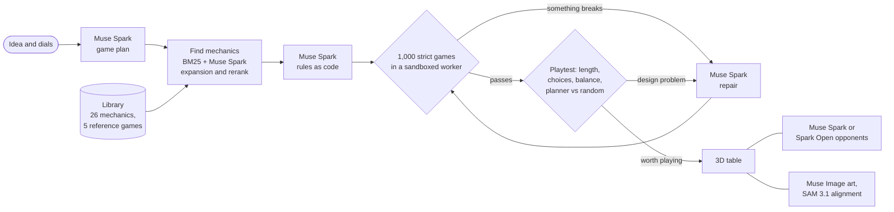

# BoardDream

Describe a board game in a sentence. BoardDream designs a strategy game for teen and adult players around it, writes the rules as code, playtests them with 1,000 random games, fixes what breaks, and deals you in on a 3D table.

Built for the [Meta Global AI Developer Hackathon](https://cerebralvalley.ai/e/meta-ai-developer-hackathon/details) (Oct 26 – Nov 4, 2026).

## How it works

1. **Design.** Muse Spark turns your idea and settings (players, length, complexity, luck) into a game plan.
2. **Find building blocks.** It picks tested mechanics from the library: card markets, drafting, deck building, worker placement, area majorities, tile placement, hex maps, trading and more ([retrieval eval](eval/retrieval/README.md)).
3. **Write the rules.** Muse Spark writes the game as code on top of those blocks.
4. **Playtest and fix.** 1,000 random games check that every game ends and nothing breaks. More games check that it is worth playing, including whether a player who plans ahead beats random play. Problems go back to the model until the rules pass ([generation benchmark](eval/generation/README.md): 24 of 24 hobby-game ideas pass, and planning beats random play in all 20 that can be measured).
5. **Play and tune.** Play on a 3D table. Muse Spark opponents trade, bluff, argue and vote, on the open-weight Muse Spark Open (Baseten) when configured ([opponents benchmark](eval/opponents/README.md)). Each game's profile (complexity, strategy, luck, interaction) is measured by playing it. Sliders change the rules and show balance as you drag.
6. **Paint.** Muse Image paints every card and the board in one style, and SAM 3.1 checks that each painted tile lines up with the real board.



## Try it

Requires Node 22+.

```sh
npm install
cp .env.example .env      # add MODEL_API_KEY
npm run dev               # http://localhost:5173
```

- Each game opens with a how-to-play card (**Rules** brings it back), and **Hint** asks the game's bot for a move.
- **Print** makes an A4 print-and-play kit (rules, board, cards with cut lines) to test a game on a real table.
- `?game=lantern-isles&watch` lets bots play a whole game.
- `F` hides the side panels.
- `?quality=low` helps slow GPUs; `?flat` switches to a 2D table.
- **Results** (or `?results`) shows every benchmark on one page.
- Deploying: a free static demo with AI opponents on Cloudflare Pages, or the full server in a container ([docs/DEPLOY.md](docs/DEPLOY.md)).

```sh
npm test
npm run eval:retrieval
npm run eval:generation
```

## Code

| Folder | Contents |
| --- | --- |
| `packages/engine` | Game interface, fuzzer, balance simulator |
| `packages/library` | Mechanics, the original reference games Glasshouse, Lantern Isles, Highsail, Wildmere and Fenlight, catalog, small classic games used only as engine test fixtures |
| `packages/retrieval` | BM25 search and IR metrics |
| `apps/server` | Muse Spark pipeline and rules sandbox |
| `apps/web` | React + three.js app, and the edge functions for the static demo |
| `eval/` | Retrieval, generation, opponents and reference-game benchmarks |

## Built during the hackathon

All code was written after kickoff on Oct 26, 2026. The day-by-day plan and progress are in [docs/PLAN.md](docs/PLAN.md).

- **Oct 26:** engine, fuzzer, first reference game, search, app shell.
- **Oct 27:** 21 mechanic modules, three original reference games (Glasshouse, Lantern Isles, Highsail) and seven small test games, retrieval eval, 3D table, end-to-end game generation, playtesting with a strategic-depth check, Muse Spark opponents, card and board art.
- **Oct 28:** tile placement with edge matching, and Wildmere, a fourth original reference game built on it; card drafting, deck building and set collection modules; the generation benchmark rebuilt on hobby-game ideas; AI opponents on Muse Spark Open; a cooperative shared-threat module; Fenlight, a social deduction game where AI players argue and vote; game profiles measured by simulation; a results page; deployment setup; how-to-play cards and hints.
