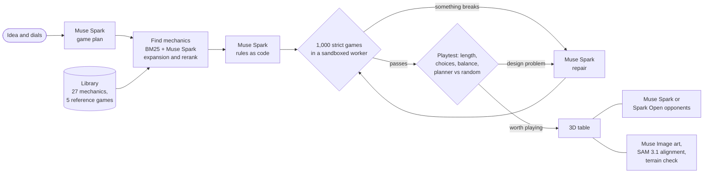

# BoardDream

Describe a board game in a sentence. BoardDream designs a strategy game for teen and adult players around it, writes the rules as code, playtests them with 1,000 random games, fixes what breaks, and deals you in on a 3D table.

Built for the [Meta Global AI Developer Hackathon](https://cerebralvalley.ai/e/meta-ai-developer-hackathon/details) (Oct 26 – Nov 4, 2026).

**Play the demo: [boarddream.pages.dev](https://boarddream.pages.dev)**, with the demo games, a game BoardDream made, and Muse Spark Open opponents. Making new games and inviting friends need the full server (see [Try it](#try-it)).

## How it works

1. **Design.** Muse Spark turns your idea and settings (players, length, complexity, luck) into a game plan. The setting decides the parts and the table (a river festival is a line of stalls, a city a grid of districts), and each new game differs from the last few in its board, mechanics and name. Cards get abilities that set each other off: a played card can reward the next card of a kind, or make a kind cheaper.
2. **Find building blocks.** It picks tested mechanics from the library: card markets, drafting, deck building, worker placement, area majorities, tile placement, hex maps, trading and more ([retrieval eval](eval/retrieval/README.md)).
3. **Write the rules.** Muse Spark writes the game as code on top of those blocks.
4. **Playtest and fix.** 1,000 random games check that every game ends and nothing breaks. More games check that it is worth playing, including whether a player who plans ahead beats random play. Problems go back to the model until the rules pass ([generation benchmark](eval/generation/README.md): 24 of 24 hobby-game ideas pass; planning clearly pays in 18 of the 20 that can be measured). A game takes about three minutes, and you watch it take shape: each step is listed on the left while the middle of the page assembles the game (a box cover, mechanic cards from the library, the components and the rules), then bots play the first draft on the table while it is tested.
5. **Play and tune.** Play on a 3D table that reacts to you: water is a glossy jelly that ripples under the pointer and wobbles when touched, grass and wheat sway and part, stone glitters and chips, and tokens fall with real physics. Cards whose abilities fire flash gold, and every change to a resource or score floats up off its chip. It draws nothing while nothing moves, so it runs on laptop GPUs. Muse Spark opponents trade, bluff, argue and vote, on the open-weight Muse Spark Open (Baseten) when configured ([opponents benchmark](eval/opponents/README.md)). Each game's profile (complexity, strategy, luck, interaction) is measured by playing it. The **Designer** drawer holds the rule sliders, the balance as you drag them, the art and the log.
6. **Paint.** Muse Image paints a box cover for every game, and every card and the board, in one style. SAM 3.1 checks that each painted tile lines up with the real board, and a color check moves tiles painted as the wrong terrain.



## Try it

Requires Node 22.13+.

```sh
npm install
cp .env.example .env      # add MODEL_API_KEY
npm run dev               # http://localhost:5173
```

What each key turns on:

- **No key:** the demo games against bots, the balance and profile of every game, print and play, and tables with friends.
- **`MODEL_API_KEY`** (Meta Model API): making games, changing rules in words, art, and Muse Spark opponents.
- **`OPEN_MODEL_API_KEY` and `OPEN_MODEL_BASE_URL`** (optional, e.g. Baseten): Muse Spark Open plays the opponents instead.

Around the app:

- The home page asks what you want to play. Type an idea, pick an example or press **Surprise me**, then **Dream it up**; the dials are under **Advanced settings**. Below are the four demo games and your newest one.
- A first game opens with a short note on how to win. The bar at the bottom says what to do each turn, what you can click glows, and **Hint** marks the bot's move on the table. **Rules** has the full rules.
- **Invite friends** (on the table's bar) opens a table for the game and gives you a link. Friends sign in with a name and a password and take a seat; seats nobody takes are played by bots, and the server referees every move. It needs the full server, not the static demo.
- **Print and play** (in the `…` menu) makes an A4 kit (rules, board, cards with cut lines) to test a game on a real table.
- On a generated game, **Change the rules** takes a change in plain words; the new rules are tested again and compared with the old ones.
- `?game=lantern-isles&watch` lets bots play a whole game.
- **Designer** (or `F`) opens the drawer; `Esc` closes it and any open page.
- **Games** lists every game with its cover; a generated one can be deleted there, and a newly made one offers **Don't keep it**.
- `?quality=low` helps slow GPUs; `?flat` switches to a 2D table.
- **Behind the scenes** (or `?results`) shows every benchmark on one page.
- `npm run covers` paints a cover for every game that has none.
- Deploying: a free static demo with AI opponents on Cloudflare Pages, or the full server in a container ([docs/DEPLOY.md](docs/DEPLOY.md)).

```sh
npm test
npm run eval:retrieval            # replays the committed Muse Spark replies; no key needed
npm run eval:generation -- g01    # live calls; all 24 ideas, three at a time, take 30-45 minutes and $4-5
```

## Code

| Folder | Contents |
| --- | --- |
| `packages/engine` | Game interface, fuzzer, balance simulator |
| `packages/library` | Mechanics, the four original demo games (Lantern Isles, Highsail, Wildmere, Fenlight), catalog, and games used only as engine tests and retrieval references (Glasshouse and small classics) |
| `packages/retrieval` | BM25 search and IR metrics |
| `apps/server` | Muse Spark pipeline and rules sandbox |
| `apps/web` | React + three.js app, and the edge functions for the static demo |
| `eval/` | Retrieval, generation, opponents and reference-game benchmarks |
