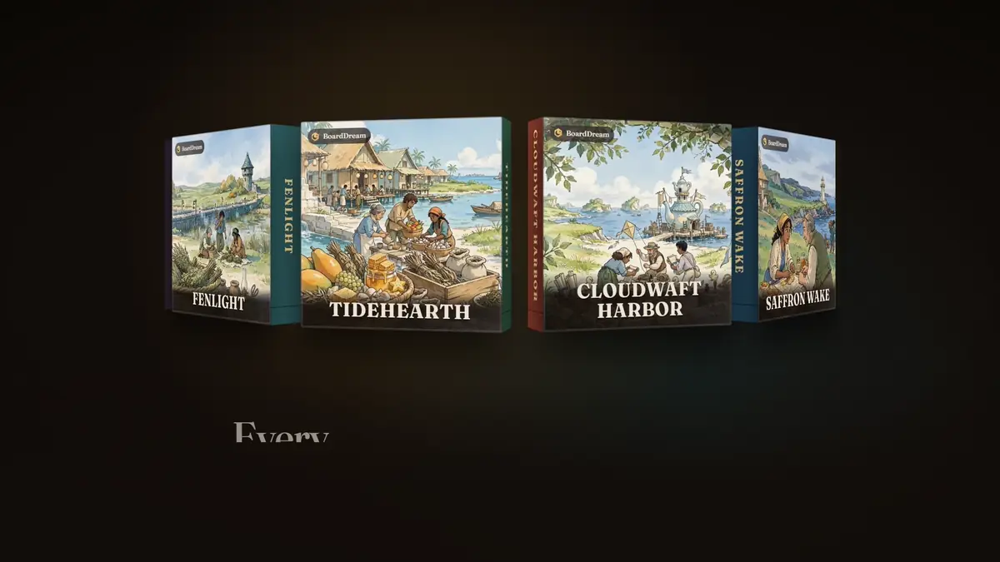
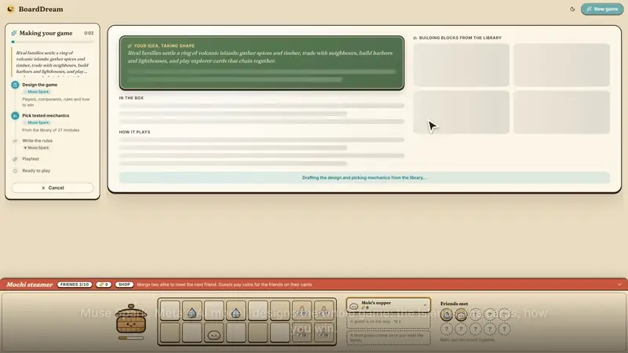
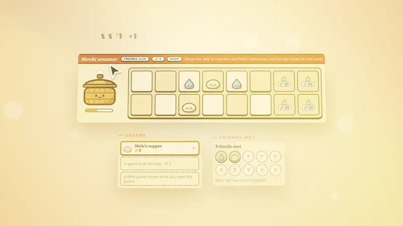
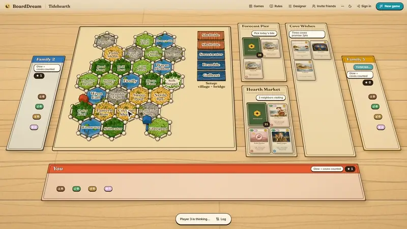
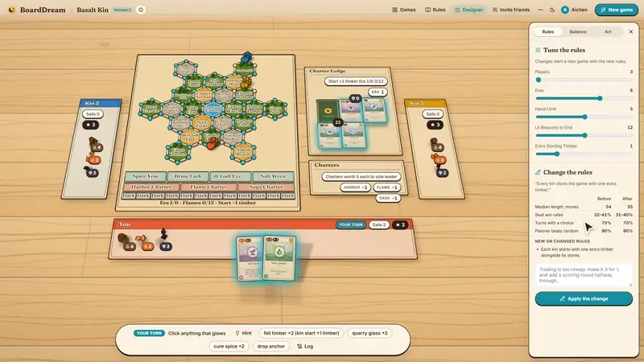
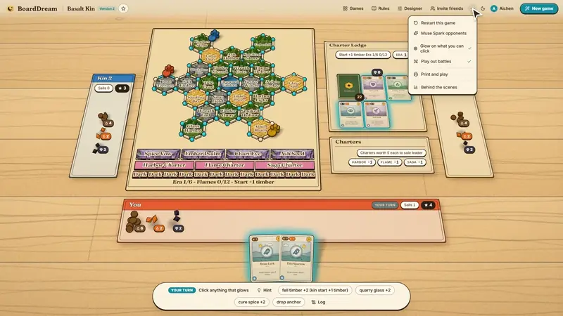
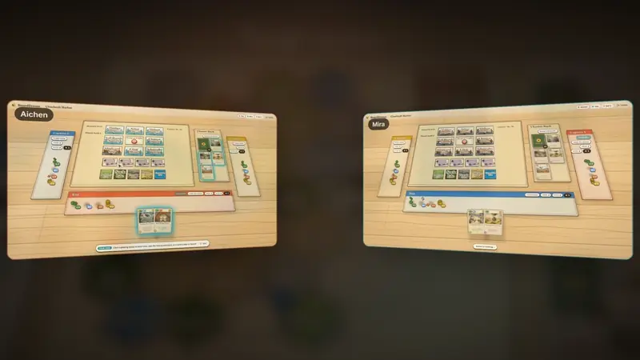
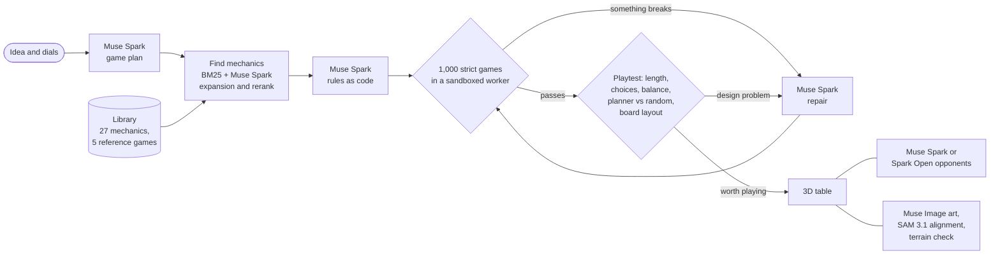

<div align="center">



# BoardDream

### Describe a board game in one sentence. Play it with your friends tonight.

[](https://boarddream.pages.dev)
[](#four-meta-models-four-jobs)

Built for the [Meta Global AI Developer Hackathon](https://cerebralvalley.ai/e/meta-ai-developer-hackathon/details), Oct 26 – Nov 4, 2026.

</div>

## Game night, every night

My friends and I play board games every week, and we ran out of new ones. Making your own takes weeks: write the rules, cut a paper prototype, wait for a playtest night, fix what was not fun, and do it all again.

**BoardDream does it in minutes.** You type one sentence. It designs the game, writes the rules as code, has bots play it a thousand times, fixes whatever breaks, and puts it on a 3D table you share with friends by a link.

## How it works



| 1. Describe it | 2. BoardDream makes it | 3. Play it together |
| --- | --- | --- |
| One sentence, or **Surprise me**. Pick the players, length and complexity. | Muse Spark designs the game on tested building blocks and writes its rules as code. Bots play it 1,000 times; anything that breaks goes back to be fixed. | A 3D table, a painted board, a rulebook. Friends join by a link, and AI takes any empty seat. |

## See it

<table>
<tr>
<td width="50%"><br><b>A game made from one sentence</b><br>Every step on the left, the game taking shape in the middle.</td>
<td width="50%"><br><b>A little game while you wait</b><br>Steam a friend, put two alike together.</td>
</tr>
<tr>
<td><br><b>A table that reacts</b><br>Water ripples under the pointer, pieces land with real physics.</td>
<td><br><b>House rules in plain words</b><br>The game is rewritten, tested again, and shown side by side.</td>
</tr>
<tr>
<td><br><b>Print and play</b><br>Rules, board and cards on A4, for a real table.</td>
<td><br><b>One table for everyone</b><br>Send a link; bots fill the seats nobody takes.</td>
</tr>
</table>

## Four Meta models, four jobs

| Model | Its job in BoardDream |
| --- | --- |
| **Muse Spark** | Designs each game, picks its building blocks, writes the rules as code, and fixes them |
| **Muse Spark Open** | Plays the empty seats, and talks at the table: trades, bluffs, argues and votes |
| **Muse Image** | Paints every game's box cover, cards and board |
| **SAM 3.1** | Checks that every painted tile sits on the real board |

## Measured, not guessed

Every number comes from a benchmark in this repository, and **Behind the scenes** in the app shows them all.

| | |
| --- | --- |
| **24 / 24** | game ideas end up with working rules (16 on the first draft, the rest after one fix) · [generation](eval/generation/README.md) |
| **78%** | of games won by a bot that plans ahead, against a fair share of 34%: choices matter · [generation](eval/generation/README.md) |
| **0.81 → 0.97** | how well the right building blocks are found (nDCG), with Muse Spark expanding and reranking the search · [retrieval](eval/retrieval/README.md) |
| **19 / 19** | painted tiles lined up with the real board, checked by SAM 3.1 · [plan](docs/PLAN.md) |

## Built during the hackathon

Everything here was made from scratch for the Meta Global AI Developer Hackathon, Oct 26 – Nov 4, 2026. The history starts at kickoff with a two-line README, and every commit since is in this repository's public log.

**What we built:** the game-design pipeline (plan, mechanic search, rules written as code, a 1,000-game fuzzer, repair and playtest), the library of 27 tested mechanics and the reference games, the 3D table with physics, house rules in plain words, the Balance profile, board and card art with alignment checks, print and play, tables with friends, the mochi game, Behind the scenes, and every benchmark in `eval/`.

**What we used:** Meta's Muse Spark, Muse Spark Open, Muse Image and SAM 3.1 through their APIs, and open-source libraries (React, three.js, React Three Fiber, Rapier, Vite, Fraunces and Inter fonts, Lucide icons). The demo video was made with video-shotcraft and Remotion from screen recordings of the app (Playwright and ffmpeg).

## Try it

**Online:** [boarddream.pages.dev](https://boarddream.pages.dev) has the demo games and Muse Spark Open opponents. Making new games and tables with friends need the full server.

**On your computer** (Node 22.13+):

```sh
npm install
cp .env.example .env      # add MODEL_API_KEY
npm run dev               # http://localhost:5173
```

- **No key:** the demo games against bots, balance and profiles, print and play, tables with friends.
- **`MODEL_API_KEY`** (Meta Model API): making games, changing rules in words, art, Muse Spark opponents.
- **`OPEN_MODEL_API_KEY`** and **`OPEN_MODEL_BASE_URL`** (optional, e.g. Baseten): Muse Spark Open plays the opponents.

<details>
<summary><b>More to try</b></summary>

- **Rules** has the full rulebook, with a switch to Chinese.
- **Designer** (or `F`) holds the rule sliders, the **Balance** tab (complexity, strategy, luck, interaction, measured by playing) and the art.
- **Hint** marks the bot's move on the table; what you can click glows.
- **Print and play** is in the `…` menu.
- **Games** lists every game with its cover.
- `?game=lantern-isles&watch` lets bots play a whole game; `?quality=low` helps slow GPUs; `?flat` switches to a 2D table.
- `?mochi` opens the mochi game on its own; `?results` opens Behind the scenes.
- Deploying: a free static demo on Cloudflare Pages, or the full server in a container ([docs/DEPLOY.md](docs/DEPLOY.md)).

```sh
npm test
npm run eval:retrieval            # replays the committed Muse Spark replies; no key needed
npm run eval:generation -- g01    # live calls; all 24 ideas take 30-45 minutes and $4-5
```

</details>

<details>
<summary><b>The pipeline in detail</b></summary>



</details>

## Inside the repo

| Folder | What is in it |
| --- | --- |
| `packages/engine` | The game interface, the fuzzer and the balance simulator |
| `packages/library` | 27 tested mechanics and the four hand-made games |
| `packages/retrieval` | BM25 search and its metrics |
| `apps/server` | The Muse Spark pipeline and the rules sandbox |
| `apps/web` | The React + three.js app and the demo games |
| `eval/` | Retrieval, generation, opponents and reference-game benchmarks |
| `video/` | The demo video: the app captured with Playwright, the film made in Remotion (`video/promo`) |

The plan and every decision: [docs/PLAN.md](docs/PLAN.md). What was built, day by day: [docs/BUILT.md](docs/BUILT.md).

## License

[MIT](LICENSE). The demo video's code adapts parts of video-shotcraft (Apache-2.0); its sources and licences are in [video/promo/NOTICE.md](video/promo/NOTICE.md).
